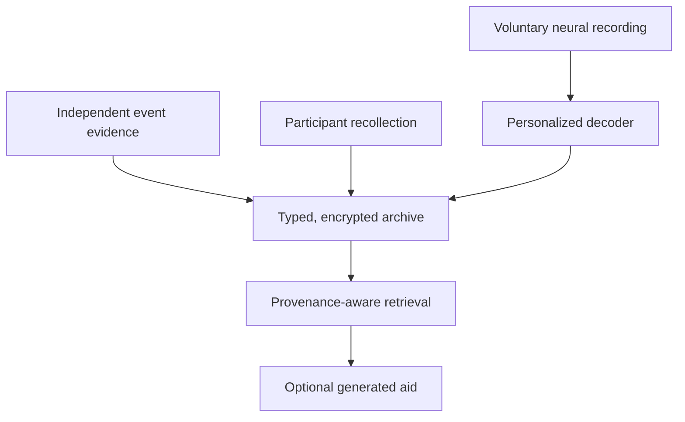

# MemStack architecture v0 — neural-assisted episodic archive

**Status: HYPOTHESIS / DESIGN. No MemStack service, BCI integration, clinical workflow, or effective memory-decoding behavior is installed or validated.**

## Design proposition

Build a personal, consent-controlled archive that preserves **different evidence streams** and tests whether neural recordings add reliable, event-specific information during voluntary recollection. An ordinary audiovisual lifelog can function without a BCI; the BCI must earn its inclusion through held-out benefit.

This is neither a biological engram file format nor a proposal that digital reconstruction transfers consciousness, identity, or subjective continuity. These remain distinct open questions.

## Evidence and data flow



A generated aid must never silently replace a participant report or an independent event record. Recording a neural correlate and accurately reconstructing a remembered event are distinct accomplishments.

## Evidence classes and trust boundary

| Class | Origin | What it establishes |
| --- | --- | --- |
| `EXTERNAL_RECORD` | Event photo/video/audio/time, independent witnesses | Observed aspects of events, limited by sensor and provenance |
| `PARTICIPANT_REPORT` | Participant's unprompted account | What a person reports recalling at a recorded time |
| `NEURAL_MEASUREMENT` | Device sensor data and acquisition metadata | Measured electrical/hemodynamic signal, not a complete memory |
| `NEURAL_INFERENCE` | Versioned statistical decoder | Estimated event, concept, or recall state, with uncertainty |
| `GENERATED_HYPOTHESIS` | AI-created text/image/audio | A plausible representation, **not evidence** it occurred |
| `UNKNOWN` | Missing or conflicting information | No supported assertion |

An item can support several claims with different sources, but no rule allows `GENERATED_HYPOTHESIS` to be promoted to `EXTERNAL_RECORD` simply by high model confidence, repetition, or user familiarity.

## Proposed minimal record

```json
{
  "record_id": "uuid",
  "event_id": "uuid-or-null",
  "participant_subject_id": "pseudonymous-reference",
  "event_time_or_interval": null,
  "observation_time": "ISO-8601-or-null",
  "record_time": "ISO-8601",
  "clock_domain": "source-clock-name",
  "temporal_uncertainty": null,
  "evidence_class": "NEURAL_MEASUREMENT",
  "payload_ref": "encrypted-object-reference",
  "source_hash": "sha256",
  "consent_scope_ref": "scope-version-reference",
  "retention_policy_ref": "policy-version-reference",
  "decoder_version": null,
  "calibration_version": null,
  "confidence_calibration_ref": null,
  "claims": [],
  "correction_of": null,
  "provenance": []
}
```

Schema is illustrative, not a deployed standard or a proof that neural inference is possible. Keep payloads separately encrypted; avoid public secrets, identifiable neural data, and raw personal media in the Git repository.

## Subsystems

1. **Consent and capture:** explicit opt-in for each source; recording active indicators; participant ability to pause, revoke future capture, and request policy-governed deletion.
2. **Ingest and time alignment:** import evidence classes independently; record source clock, timestamp uncertainty, calibration and artifact exclusions; hash source objects.
3. **Experiment registry:** version public dataset manifests, task type, reserved labels, frozen splits and evaluation settings. No unexamined merge of closed-loop and observational trials.
4. **Decoder:** start with transparent, individual-calibrated EEG features and modest baselines; separate predictions of `encoding_success`, `retrieval_state`, `known_event_identity`, and `known_concept`. Unknown classes and abstention are mandatory.
5. **Archive/query:** preserve measured/reported/decoded/generated states and corrections; retrieval may surface relevant external media but must identify it as *external evidence*.
6. **Governance/audit:** per-artifact permissions for sharing/training, retention, deletion and backups; access logs and security evaluations.

## Modeling principle

Memory content, event context, encoding quality, retrieval state and later recollection should be separate targets. Recent human single-neuron work found partly distinct content and context neuronal populations; it does not establish that an entire episode sits in one stable cell group. See [Bausch et al. 2026](https://www.nature.com/articles/s41586-025-09910-2). Longitudinal decoder recalibration is a hypothesis to test, not presumed recovery.

Brain signals may have limited incremental value once an eye tracker, prompt, recent speech, event schedule or external video is included. The primary model comparison is **context+neural versus context-only on held-out events**.

## Threat model and privacy controls

Protect raw signals, derivatives/embeddings, model weights/updates, participant reports, third-party media, and generated reconstructions. Protect from unauthorized access, re-identification, future unapproved decoding, event association mistakes, model inversion/membership inference, tampering and false certainty.

- Local-first encrypted storage and key separation; access scopes for each evidence class.
- Explicit separate permissions for recording, research training, output sharing and model export.
- Source integrity hashes, immutable correction lineage, inspectable model and consent versions.
- Participant-visible generated-content labels and no generated output preceding independent recall collection during studies.
- Per-artifact retention/deletion manifest covering live stores, backups, derived datasets and models; do not promise total machine unlearning without proof.
- Security testing prior to importing identifiable participant data.

Relevant: [UNESCO 2025 neurotechnology ethics recommendation](https://www.unesco.org/en/node/86248), [OECD Responsible Innovation in Neurotechnology](https://legalinstruments.oecd.org/en/instruments/oecd-legal-0457), and [Sandbrink & Young 2026, Communications Medicine](https://www.nature.com/articles/s43856-026-01797-y). These do not by themselves define universal U.S. legal obligations.

## Failure rules

- No held-out neural improvement over non-neural baseline ⇒ BCI-specific benefit **not established**.
- Correct known class, wrong episode-specific details ⇒ **recognition**, not event-content extraction.
- Generated plausibility without verifiable source ⇒ **hypothesis**, not faithful memory.
- Better recall task scores after stimulation ⇒ **memory enhancement**, not restored archived memory.
- Missing consent, exposed private data or conflated provenance ⇒ stop relevant data processing and correct the failure.

## Relation to BT2 conceptual sources

BT2's attached `HYPERCONNECTOME_RUNTIME_MODEL.md` and `PLASTICITY_AND_STATE_GOVERNANCE.md` distinguish measurements, epistemic support, memory admission, typed writes and provenance. Those are **conceptual software design analogies**, not deployed MemStack components or evidence that human memories can be exported. This architecture borrows the evidence/authority separation while requiring independent neuroscience validation.

See [evidence](EVIDENCE_REGISTER_20261029.md), [experiments](EXPERIMENTS_V0.md), and [adversarial review](../reviews/TKIK_BCI_MEMORY_20261029.md).
